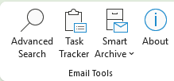
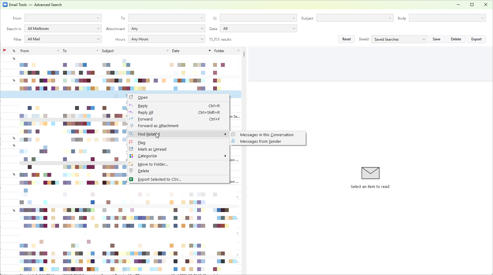
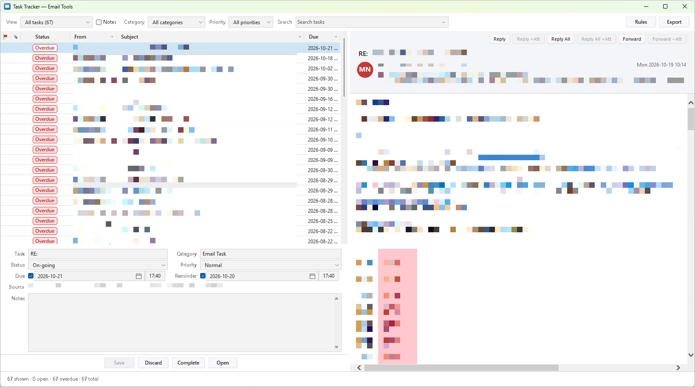
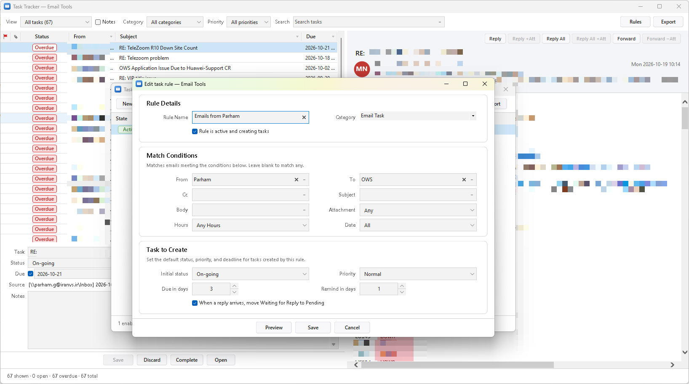
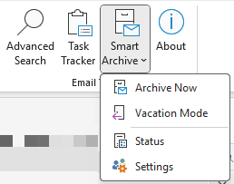
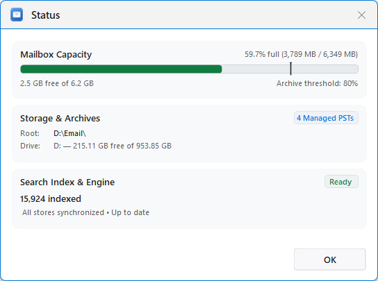
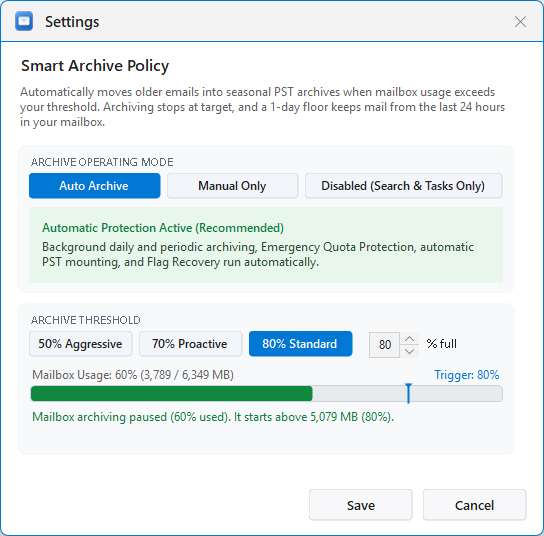
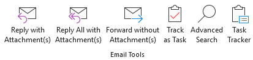
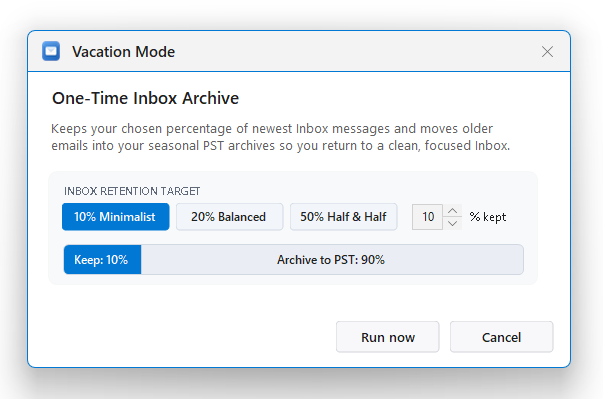

  
<a href="https://parhamghafouri.github.io/EmailTools/">English</a> &nbsp;|&nbsp; <a href="https://parhamghafouri.github.io/EmailTools/README.fa.html"><strong>فارسی</strong></a>

  

  <h1 align="center" style="text-align: center;" dir="rtl">ابزارهای ایمیل برای مایکروسافت اوت‌لوک</h1>
  

    <strong>جست‌وجوی سریع نمایه‌شده &bull; ردیابی خودکار وظایف &bull; بایگانی فصلی هوشمند &bull; همگام‌سازی نام‌های سازمانی GAL</strong> 
    <em>مجموعه‌ای یکپارچه برای جست‌وجو، پیگیری کارها و مدیریت بایگانی در اوت‌لوک، با پردازش محلی داده‌ها.</em>
  

  

    &nbsp;&nbsp; &nbsp;&nbsp;
  

  

    <strong>نصب اختصاصی برای هر کاربر</strong> &bull; بدون نیاز به دسترسی ادمین (Administrator) &bull; پردازش محلی ایمیل‌ها &bull; بررسی خودکار به‌روزرسانی‌ها
  

---

<h2 dir="rtl" align="right">🚀 معرفی افزونه</h2>

در صندوق‌های پستی بزرگ، پیدا کردن پیام‌ها، پیگیری کارها و مدیریت فضای ذخیره‌سازی دشوارتر می‌شود. افزونهٔ Email Tools این کارها را در اوت‌لوک کلاسیک ویندوز یک‌جا در دسترس قرار می‌دهد.

<strong>Email Tools</strong> یک افزونهٔ VSTO با نصب اختصاصی برای هر کاربر است که <strong>جست‌وجوی نمایه‌شدهٔ محلی</strong>، <strong>تبدیل ایمیل به وظیفه</strong>، <strong>بایگانی فصلی PST</strong>، <strong>ابزارهای پیوست</strong> و <strong>همگام‌سازی نام‌ها با GAL</strong> را فراهم می‌کند. پایگاه‌های دادهٔ جست‌وجو و وظایف روی رایانهٔ شما می‌مانند و همگام‌سازی حساب ایمیل همچنان از طریق اوت‌لوک انجام می‌شود.

  

---

<h2 dir="rtl" align="right">✨ امکانات در یک نگاه</h2>

<table dir="rtl" width="100%">
  <thead><tr><th align="right">قابلیت</th><th align="right">امکانات Email Tools</th></tr></thead>
  <tbody>
    <tr><td><strong>جست‌وجوی پیشرفته</strong></td><td>نمایهٔ محلی متن و اطلاعات پیام‌ها در صندوق‌ها و آرشیوهای PST متصل</td></tr>
    <tr><td><strong>ردیاب وظایف</strong></td><td>تبدیل ایمیل به وظیفه، قوانین خودکار، کارت‌های وضعیت، سررسید و یادداشت</td></tr>
    <tr><td><strong>فیلتر پیوست</strong></td><td>جست‌وجوی وجود فایل پیوست، نام فایل و پسوندهایی مانند <code dir="ltr">*.pdf</code> و <code dir="ltr">*.xlsx</code></td></tr>
    <tr><td><strong>بایگانی هوشمند</strong></td><td>آرشیو فصلی PST، پایش ظرفیت و آغاز فایل جدید در سقف ۴۵ گیگابایت</td></tr>
    <tr><td><strong>ابزارهای پیوست</strong></td><td>پاسخ یا پاسخ به همه همراه با فایل‌های پیوست؛ فوروارد بدون فایل‌های پیوست</td></tr>
    <tr><td><strong>همگام‌سازی نام‌ها</strong></td><td>تطبیق نام‌های نمایشی پیام‌های گذشته با دفترچهٔ سازمانی GAL در پس‌زمینه</td></tr>
    <tr><td><strong>حالت مرخصی</strong></td><td>نگه‌داشتن درصد دلخواهی از پیام‌های جدید صندوق ورودی و بایگانی باقی پیام‌ها</td></tr>
    <tr><td><strong>پاک‌سازی یادآورها</strong></td><td>بستن یادآورهای جلساتی که پایان یافته‌اند</td></tr>
    <tr><td><strong>ذخیره‌سازی محلی</strong></td><td>نگه‌داری نمایهٔ جست‌وجو، پایگاه دادهٔ وظایف و آرشیوها روی رایانهٔ شما</td></tr>
  </tbody>
</table>

---

<h2 dir="rtl" align="right">🔍 راهنمای بخش‌های کلیدی</h2>

<h3 dir="rtl" align="right">۱. جست‌وجوی پیشرفته (Advanced Search با نمایهٔ محلی)</h3>

پنجره‌ای مستقل با فیلترهای ترکیبی، نتایج قابل مرتب‌سازی، جدول مجازی و پیش‌نمایش یکپارچهٔ پیام‌ها.

  
   
  <em>جست‌وجوی پیام‌های نمایه‌شده در صندوق‌های پستی، آرشیوهای PST متصل و پوشه‌های گفت‌وگو.</em>

<ul dir="rtl" align="right">
  <li><strong>موتور ایندکس SQLite FTS5 Trigram:</strong> جست‌وجوی متن پیام‌های نمایه‌شده با نمایهٔ محلی، مستقل از Windows Search. نمایه‌سازی اولیه و همگام‌سازی بعدی در پس‌زمینه انجام می‌شود؛ سرعت جست‌وجو به عبارت، پوشش نمایه و رایانه بستگی دارد.</li>
  <li><strong>فیلتر اختصاصی نام و پسوند پیوست:</strong> جست‌وجوی مستقیم در نام فایل‌های ضمیمه با الگوهای Wildcard (مانند <code dir="ltr">*.pdf</code> یا <code dir="ltr">*.xlsx</code>) همراه با فیلتر خودکار تصاویر امضا.</li>
  <li><strong>پیش‌نمایش امن ایزوله‌شده (Sandboxed Preview):</strong> استفاده از Mark-of-the-Web و مسدودسازی اسکریپت‌ها، تصاویر ردگیر و درخواست‌های خارجی در پیش‌نمایش.</li>
  <li><strong>برجسته‌سازی و کلیدهای پرش:</strong> هایلایت واژه‌های جست‌وجوشده در پیش‌نمایش و جابه‌جایی سریع میان تطابق‌ها با دکمه‌های Previous / Next.</li>
  <li><strong>ترکیب فیلترها:</strong> امکان جست‌وجوی همزمان بر اساس فرستنده، گیرنده، رونوشت، موضوع، متن، نام پیوست، بازهٔ تاریخ و ساعات مشخص روز.</li>
  <li><strong>منوی راست‌کلیک کامل:</strong> باز کردن، پاسخ، فوروارد، پرچم‌گذاری، دسته‌بندی رنگی، انتقال، حذف، نمایش گفت‌وگوهای مرتبط و خروجی اکسل (CSV) با محافظت ضدتزریق فرمول.</li>
</ul>

<strong>راهنمای جست‌وجو:</strong> منتظر پایان نمایه‌سازی اولیه بمانید و آرشیوهای PST موردنیاز را در اوت‌لوک متصل نگه دارید. برای جست‌وجوی پسوند، گزینهٔ <strong dir="ltr">Attachment → Yes</strong> را انتخاب کرده و <code dir="ltr">*.txt</code>، <code dir="ltr">*.pdf</code> یا <code dir="ltr">*.xlsx</code> را در کادر نام فایل وارد کنید. فیلترهای ساعات کاری و غیرکاری از تنظیمات تقویم اوت‌لوک شما استفاده می‌کنند.

---

<h3 dir="rtl" align="right">۲. ردیاب هوشمند وظایف و خودکارسازی کارها (Task Tracker)</h3>

تبدیل ایمیل‌ها به وظایف دارای سررسید، اولویت، یادداشت و وضعیت پیگیری. جست‌وجوی Task Tracker در وظایف ثبت‌شده انجام می‌شود؛ جست‌وجوی پیشرفته پیام‌های نمایه‌شده را جست‌وجو می‌کند.

  
   
  <em>کارت‌های خلاصه وضعیت به سبک کانبان، جدول شفاف وظایف و پنل جانبی بررسی زمینهٔ کامل مکاتبه.</em>

<ul dir="rtl" align="right">
  <li><strong>کارت‌های آماری وضعیت به سبک کانبان:</strong> دسته‌بندی بصری وظایف در وضعیت‌های <strong>برای انجام (To Do)</strong>، <strong>در حال انجام (In Progress)</strong>، <strong>در انتظار پاسخ (Waiting for Reply)</strong>، <strong>انجام‌شده (Completed)</strong> و <strong>معوق/سررسیدگذشته (Overdue)</strong> با شمارنده‌های زنده.</li>
  <li><strong>ویرایشگر پیشرفتهٔ قوانین خودکارسازی:</strong> تعریف قوانین دقیق برای تبدیل خودکار ایمیل‌های دریافتی یا ارسالی به وظیفه، بر اساس فرستنده، گیرنده، کلمات کلیدی موضوع یا متن، پسوند فایل‌های پیوست و مهلت انجام.</li>
  <li><strong>تغییر وضعیت خودکار با دریافت پاسخ (Auto-Resolve on Reply):</strong> با رسیدن پاسخ به ایمیلی که منتظر بازخورد آن بوده‌اید، وظیفه به صورت خودکار از حالت «در انتظار» خارج شده و به گردش کار فعال بازمی‌گردد.</li>
  <li><strong>پنل جامع بررسی جزئیات:</strong> مشاهدهٔ دقیق موضوع، فرستنده، گیرندگان اصلی و رونوشت، مهلت انجام، یادداشت‌های شخصی و امکان پرش مستقیم به ایمیل در اوت‌لوک.</li>
  <li><strong>طراحی مدرن ویندوز ۱۱:</strong> هماهنگ با زبان طراحی Fluent 2 مایکروسافت، گوشه‌های کاملاً گرد، حاشیه‌های نرم آنتی‌الیاس و سازگاری کامل با تم‌های روشن، خاکستری و مشکی.</li>
</ul>

  
   
  <em>پنجرهٔ طراحی قوانین با پشتیبانی از شروط ترکیبی، استثناها، تعیین اولویت و تنظیم بازه‌های سررسید پیش‌فرض.</em>

---

<h3 dir="rtl" align="right">۳. بایگانی هوشمند (Smart Archive) و مدیریت ظرفیت</h3>

بایگانی هوشمند با انتقال پیام‌های قدیمی به فایل‌های PST فصلی محلی، مانند <code dir="ltr">2026-Season1.pst</code>، به مدیریت فضای صندوق کمک می‌کند.

  

<ul dir="rtl" align="right">
  <li><strong>داشبورد مدرن وضعیت و سلامت (Fluent 2):</strong> گیج‌های تصویری پیشرفت، نمایش سهمیهٔ فعال با رنگ‌های هشداردهندهٔ سبز/نارنجی/قرمز و نوار ظرفیت آزاد درایو آرشیو.</li>
  <li><strong>شتاب‌بخشی هوشمند به چرخه بایگانی:</strong> بررسی سن قدیمی‌ترین ایمیل‌ها و پرش از بازه‌های زمانی خالی، همراه با اولویت‌بندی از قدیمی‌ترین تاریخ در زمان پر شدن صندوق.</li>
  <li><strong>حفاظت اضطراری از سهمیه (Emergency Quota):</strong> اولویت‌بندی پیام‌های قدیمی برای بایگانی با توجه به میزان مصرف صندوق و آستانه‌های تنظیم‌شده.</li>
  <li><strong>بخش‌بندی فصلی و سقف ۴۵ گیگابایت:</strong> تفکیک آرشیو هر سال به چهار فصل و آغاز فایل جدید در سقف ۴۵ گیگابایت، برای حفظ فاصله از محدودیت اندازهٔ PST.</li>
  <li><strong>وقفهٔ ایمن ۲ ساعته:</strong> توقف کامل اسکن‌های مداوم پس از رسیدن صندوق به حجم ایمن تنظیمی جهت جلوگیری از درگیری بیهودهٔ دیسک و پردازنده.</li>
  <li><strong>پنجره‌های با گوشه‌های گرد و سبک:</strong> هماهنگی پنجره‌های وضعیت، تنظیمات و بایگانی با پوستهٔ اوت‌لوک.</li>
</ul>

  
  &nbsp;&nbsp;&nbsp;&nbsp;
  

---

<h3 dir="rtl" align="right">۴. عملیات یک‌کلیکی فایل‌های پیوست و گردش کار در ریبون Home</h3>

دکمه‌های پرکاربرد مستقیماً در زبانهٔ اصلی اوت‌لوک برای افزایش سرعت مکاتبات و پیگیری وظایف روزمره:

  

<ul dir="rtl" align="right">
  <li><strong>پاسخ با پیوست‌ها (Reply with Attachment):</strong> ایجاد پاسخ و کپی کردن فایل‌های پیوست پیام اصلی در پیش‌نویس پاسخ.</li>
  <li><strong>پاسخ به همه با پیوست‌ها (Reply All with Attachment):</strong> ایجاد پیش‌نویس پاسخ به همهٔ شرکت‌کنندگان، همراه با فایل‌های پیوست پیام اصلی.</li>
  <li><strong>فوروارد بدون پیوست (Forward without Attachment):</strong> حذف فایل‌های حجیم برای صرفه‌جویی در پهنای باند با حفظ هوشمندانهٔ تصاویر امضای شرکتی.</li>
  <li><strong>ثبت سریع به عنوان وظیفه (Track as Task):</strong> تبدیل یک‌کلیکی ایمیل به وظیفه و همگام‌سازی فوری با پنل مدیریت وظایف (Task Tracker).</li>
</ul>

---

<h3 dir="rtl" align="right">۵. همگام‌سازی نام‌های نمایشی با GAL بدون اختلال</h3>

هنگامی که همکاران در دایرکتوری سازمانی (Active Directory / Exchange GAL) نام، نام خانوادگی یا واحد سازمانی خود را تغییر می‌دهند، نام‌های قدیمی در پیام‌های گذشته، قوانین و فیلترهای اوت‌لوک باقی می‌مانند.

<ul dir="rtl" align="right">
  <li><strong>انطباق ایمن آدرس‌ها:</strong> شناسایی دقیق آدرس ایمیل در دفترچه تلفن سازمانی (GAL) و به‌روزرسانی نام تنها در صورت تطابق قطعی یک‌به‌یک.</li>
  <li><strong>اصلاح قوانین و دیدگاه‌ها در خارج از پروسهٔ اصلی:</strong> اصلاح قوانین (Rules)، پوشه‌های جست‌وجو (Search Folders) و نماها (Views) پس از بسته شدن اوت‌لوک برای جلوگیری از قفل‌شدن رابط کاربری.</li>
  <li><strong>ذخیرهٔ چک‌پوینت‌های پیشرفت:</strong> ذخیره‌سازی منظم وضعیت انجام عملیات تا در صورت راه‌اندازی مجدد ویندوز، فرایند از همان نقطه ادامه یابد.</li>
</ul>

---

<h3 dir="rtl" align="right">۶. حالت مرخصی (Vacation Mode) و پاک‌سازی یادآورها</h3>

  

<ul dir="rtl" align="right">
  <li><strong>حالت مرخصی (Vacation Mode):</strong> سبک‌سازی صندوق ورودی پیش از عزیمت به مرخصی؛ نگه‌داشتن درصد مشخصی از پیام‌های جدید (مثلاً ۱۰٪ آخر) و بایگانی امن باقی پیام‌ها.</li>
  <li><strong>بستن خودکار یادآورهای معوق:</strong> بستن بی‌صدا و خودکار پنجره‌های هشدار تقویم برای جلساتی که زمان آن‌ها سپری شده است.</li>
</ul>

---

<h2 dir="rtl" align="right">📦 راهنمای نصب و ارتقا</h2>

<h3 dir="rtl" align="right">نصب اولیه</h3>
<ol dir="rtl" align="right">
  <li>فایل <strong><code dir="ltr">EmailTools_Setup.rar</code></strong> را از بخش <a href="https://github.com/ParhamGhafouri/EmailTools/releases/latest/download/EmailTools_Setup.rar">آخرین نسخه (Latest Release)</a> دانلود کنید.</li>
  <li>بسته را استخراج کنید، پیش‌نویس‌ها را ذخیره کرده و اوت‌لوک را ببندید؛ سپس <strong><code dir="ltr">EmailTools_Setup.exe</code></strong> را اجرا کنید.</li>
  <li>مایکروسافت اوت‌لوک را باز کنید؛ زبانهٔ <strong>Email Tools</strong> آمادهٔ استفاده است.</li>
</ol>

<h3 dir="rtl" align="right">ارتقا از نسخه‌های پیشین</h3>
<ul dir="rtl" align="right">
  <li><strong>نیازی به حذف نسخهٔ قبلی نیست.</strong> پیش‌نویس‌ها را ذخیره کنید، اوت‌لوک را ببندید و فایل نصب جدید را اجرا کنید. تنظیمات و پایگاه‌های دادهٔ موجود حفظ شده و در صورت نیاز ارتقا می‌یابند.</li>
  <li><strong>مهاجرت خودکار ساختار داده‌ها:</strong> ساختار پایگاه‌های دادهٔ جست‌وجو و وظایف در صورت نیاز به‌روز می‌شود. زمان ارتقا و نمایه‌سازی به داده‌ها و تغییرات نسخه بستگی دارد.</li>
</ul>

---

<h2 id="requirements" dir="rtl" align="right">💻 پیش‌نیازهای سیستم</h2>

<table dir="rtl" width="100%">
  <thead>
    <tr>
      <th align="right" width="35%">مشخصه</th>
      <th align="right" width="65%">حداقل نیازمندی</th>
    </tr>
  </thead>
  <tbody>
    <tr>
      <td><strong>سیستم‌عامل</strong></td>
      <td>ویندوز ۱۰ یا ویندوز ۱۱؛ ویندوز ۱۱ به سیستم ۶۴ بیتی نیاز دارد</td>
    </tr>
    <tr>
      <td><strong>مایکروسافت اوت‌لوک</strong></td>
      <td>اوت‌لوک کلاسیک ویندوز: ۲۰۱۶، ۲۰۱۹، ۲۰۲۱ یا مایکروسافت ۳۶۵؛ آفیس ۳۲ یا ۶۴ بیتی</td>
    </tr>
    <tr>
      <td><strong>بستر اجرایی</strong></td>
      <td>مایکروسافت دات‌نت فریم‌ورک نسخه ۴.۸ یا جدیدتر</td>
    </tr>
    <tr>
      <td><strong>سطح دسترسی کاربر</strong></td>
      <td><strong>کاربر عادی (Standard User)</strong> - بدون نیاز به دسترسی Administrator</td>
    </tr>
  </tbody>
</table>

<strong>سازگاری:</strong> این افزونهٔ VSTO در New Outlook، نسخهٔ وب اوت‌لوک و اوت‌لوک مک اجرا نمی‌شود. نصب پیش‌نیازهای ویندوز، دات‌نت یا آفیس در رایانه‌های سازمانی ممکن است به کمک واحد فناوری اطلاعات نیاز داشته باشد.

---

<h2 id="security" dir="rtl" align="right">🛡️ حریم خصوصی، امنیت و معماری</h2>

پردازش جست‌وجو، وظایف و بایگانی در Email Tools به صورت محلی انجام می‌شود. ارتباط با حساب ایمیل و دفترچهٔ سازمانی همچنان از طریق اوت‌لوک و سرویس‌های سازمان شما برقرار است.

<ul dir="rtl" align="right">
  <li><strong>اجرای ۱۰۰٪ محلی (On-Premise / Local):</strong> تمامی کوئری‌های دیتابیس، ایندکس‌گذاری متن پیام‌ها و عملیات بایگانی صرفاً بر روی رایانهٔ محلی شما انجام می‌شود.</li>
  <li><strong>بدون تحلیل خارجی محتوای ایمیل:</strong> افزونه محتوای ایمیل را برای تحلیل به سرویس شخص ثالث ارسال نمی‌کند. بررسی و دریافت به‌روزرسانی‌ها با GitHub ارتباط دارد.</li>
  <li><strong>موتور پیش‌نمایش ایزوله‌شده:</strong> پیش‌نمایش ایمیل‌ها تحت سیاست Mark-of-the-Web و با مهار اسکریپت‌ها، تصاویر ردگیر (Web Beacons) و درخواست‌های نامطمئن شبکه نمایش داده می‌شود.</li>
  <li><strong>امضای دیجیتال (Authenticode):</strong> فایل‌های اجرایی محصول و نصب‌کننده دارای امضای Authenticode و مهر زمانی RFC 3161 هستند. گواهی ناشر خودامضا است؛ وضعیت اعتماد ویندوز و هشدارهای SmartScreen به سیاست رایانه یا سازمان بستگی دارد.</li>
</ul>

---

  <h2 align="center" style="text-align: center;" dir="rtl">🌟 پشتیبانی و مشارکت</h2>

  

    اگر ابزارهای Email Tools در صرفه‌جویی زمان یا مدیریت حجم ایمیل‌هایتان به شما کمک کرده است، لطفاً با دادن یک ستاره (Star) به این مخزن در گیت‌هاب از پروژه حمایت کنید!
  

  

    
  

  

  

    <strong>معماری و توسعه توسط پرهام غفوری</strong> 
    &nbsp; 
    &copy; پرهام غفوری. استفادهٔ شخصی و درون‌سازمانی رایگان است؛ <a href="https://github.com/ParhamGhafouri/EmailTools/blob/main/LICENSE">شرایط مجوز</a> را ببینید.
  

